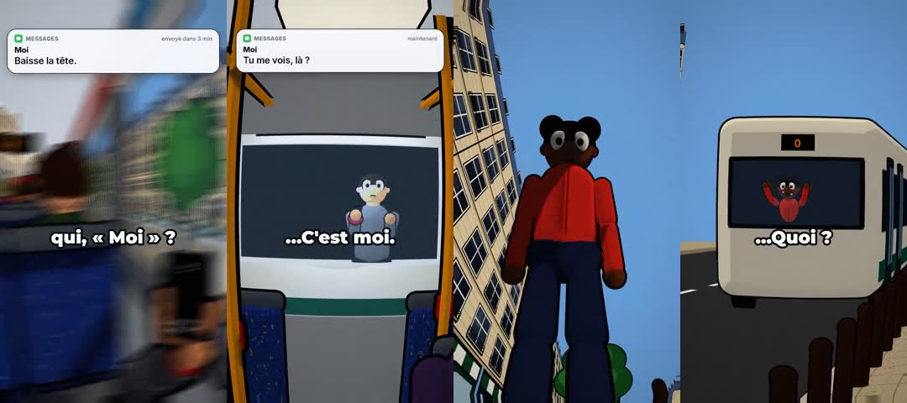

# Studio POV BD

Fabrique des vidéos TikTok **POV en 3D façon bande dessinée**, entièrement en code : pas de Blender, pas d'images générées par IA. Une scène Three.js est rendue image par image dans Chrome, puis ffmpeg assemble la vidéo, les bruitages (synthétisés eux aussi) et les voix.



L'exemple fourni s'appelle **« Moi », Partie 1** ([exemple/partie1.mp4](exemple/partie1.mp4), 55 s). Un contact nommé « Moi » envoie des SMS qui se réalisent quelques secondes plus tard. Le fichier sert de modèle : tu gardes le style et le moteur, et tu remplaces l'histoire.

## Démarrer en 1 message avec Claude

Il te faut **Claude Code** (l'appli Claude pour ordinateur, onglet Code, ou `claude` dans un terminal). Le Claude du site web ne peut pas lancer le rendu.

1. Crée un dossier vide, par exemple `mes-videos`, et ouvre-le dans Claude Code.
2. Colle ce message :

```text
Clone https://github.com/ryanop202/studio-pov-bd dans ce dossier et ouvre-le.
Installe tout, puis vérifie que l'exemple se rend correctement.
Ensuite, lis .claude/commands/nouvelle-histoire.md et suis-le exactement
pour créer ma propre série avec moi, dans le même style.
Pose-moi les questions une par une.
```

Claude installe le projet, le teste, puis t'interviewe sur ton histoire : le lieu, la source mystérieuse, le héros, le compagnon, le ton. Il te propose 3 pitchs, écrit le scénario, te prépare les textes à coller dans ElevenLabs et fabrique la vidéo.

Une fois le projet ouvert, tu peux aussi relancer tout ça à tout moment en tapant `/nouvelle-histoire`, suivi de ton idée si tu en as une.

## Les fichiers

| Fichier | Ce que tu y trouves |
|---|---|
| [GUIDE-FORMAT.md](GUIDE-FORMAT.md) | Les règles du format : rythme, retournements, SMS, sous-titres, couleurs, caméra. **À lire avant d'écrire.** |
| [FABRIQUER.md](FABRIQUER.md) | Étape par étape, de l'idée à la vidéo publiée, voix ElevenLabs comprises. |
| [CLAUDE.md](CLAUDE.md) | Le plan du code, pour Claude Code (ou pour toi si tu codes). |

## Installation (10 minutes)

Il te faut :

- **Node.js 20 ou plus** : [nodejs.org](https://nodejs.org)
- **Google Chrome** : le rendu passe par lui, sans fenêtre.
- **Python 3.10 ou plus**, seulement pour découper et vérifier les voix.

```powershell
git clone <adresse-de-ce-depot>
cd studio-pov-bd
npm install
```

Pour les outils de voix (facultatif au début) :

```powershell
python -m venv .venv
.venv\Scripts\pip install -r requirements.txt
```

Sur Mac ou Linux, remplace `.venv\Scripts\` par `.venv/bin/`.

## Tester tout de suite avec l'exemple

```powershell
npm run exemple
npm run rendu
```

`npm run exemple` copie les voix de l'exemple dans `out/voices` et les place sur la timeline. `npm run rendu` produit `out/video-1080p.mp4` (pour TikTok) et `out/video-720p.mp4` (léger). Compte 5 à 10 minutes, sans carte graphique.

Pour voir la scène en direct dans le navigateur : lance `npm run scene`, puis ouvre <http://localhost:5178>. La scène tourne en boucle, sans le son. Ajoute `?t=16` à l'adresse pour voir l'image à 16 s, ou `?play=16` pour lire à partir de 16 s.

Pour vérifier quelques instants précis sans tout rendre :

```powershell
node sheet.js 1,5,16.5,31.5,46.7 planche
```

Le résultat est une planche d'images dans `out/planche.jpg`.

## Ou en décrivant directement ton idée

Ouvre ce dossier dans **Claude Code** et décris ton histoire. Le fichier `CLAUDE.md` lui explique tout le projet et les erreurs déjà corrigées. Par exemple :

> Lis GUIDE-FORMAT.md et CLAUDE.md. Je veux une nouvelle série dans le même style : POV dans un ascenseur, une voix dans les écouteurs donne des ordres. Écris d'abord le scénario minuté de la Partie 1, je valide, puis tu codes la scène.

## Ce qui n'est pas dans ce dépôt

- **Aucune clé ElevenLabs.** Chacun utilise son propre compte. La clé reste dans `tts/cle-elevenlabs.txt`, ignoré par git.
- `node_modules/` et `out/` : ils sont recréés par `npm install` et par le rendu.

## Si quelque chose bloque

- **« ffmpeg introuvable » après `npm install` :** les versions récentes de npm peuvent bloquer le script qui télécharge ffmpeg. Autorise-le puis réinstalle :

  ```powershell
  npm install-scripts approve ffmpeg-static
  npm rebuild ffmpeg-static
  ```

- **« Chrome introuvable » :** installe Google Chrome, ou indique son chemin dans la variable `CHROME_PATH`.
- **Images noires ou vides :** lance `npm run scene` et ouvre la page dans Chrome. La console (F12) montre l'erreur.
